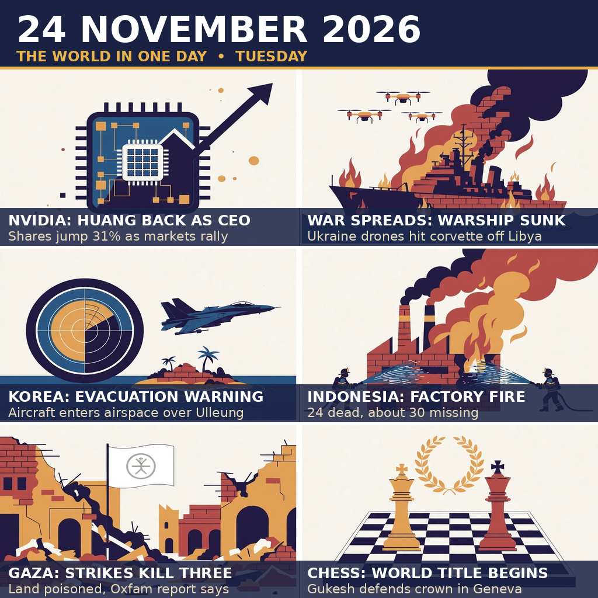

# The World in One Day — 24 November 2026

[](https://make.fun/c/news-image-20261124)
[](https://make.fun/c/news-image-20261124)
[](https://make.fun/c/news-image-20261124)

A make.fun entry for the **news-image-20261124** competition: one image summing up
the world news of Tuesday 24 November 2026.



## The day, in six stories

1. **NVIDIA — Huang back as CEO.** Nvidia's board unanimously reinstated Jensen Huang
   11 days after he resigned; shares jumped about 31%, lifting the Nasdaq ~6%.
2. **War spreads — warship sunk off Libya.** Ukraine sank a Russian corvette, the
   Merkury, in Benghazi port with maritime drones; NATO sent AWACS aircraft to Poland.
3. **Korea — evacuation warning.** South Korea briefly warned Ulleung island after an
   aircraft entered its airspace on Tuesday morning.
4. **Indonesia — factory fire.** 24 people dead and about 30 missing after a fire at a
   candy factory in Cikande, Banten.
5. **Gaza — strikes kill three.** Israeli strikes killed three people, including a
   UNRWA worker; an Oxfam report found the land poisoned by the assault.
6. **Chess — world title begins.** The World Chess Championship opened in Geneva, with
   D. Gukesh defending his crown against Javokhir Sindarov.

Sources are listed in the research notes held with the build; every fact above was
verified against Reuters and other major outlets on 24 November 2026.

## How it works

`main.ts` (Node 22, standard library only) copies the shipped `entry.png` to the
output directory, after checking it is a whole PNG under the 1 MiB cap. It runs
with no network and writes identical bytes on every run.

```sh
mkdir -p out && MAKEFUN_OUTPUT_DIR=out node main.ts
```

## License

MIT — see [LICENSE](LICENSE).
